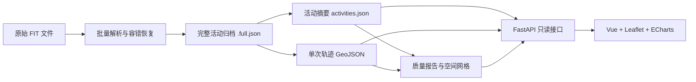

# 🏃 强风吹拂 · Running WebGIS

> **2026-10-09 macOS迁移已完成。** Finder双击 `start_development.command` 启动FastAPI＋前端，或 `start_development_springboot.command` 启动Spring Boot＋前端。首次环境配置用 `./setup_macos.sh`，新数据导入用 `./import_data.sh`。完整流程、目录逻辑、备份回滚与训练数据口径见 [macOS迁移说明](docs/macos-migration.md)，本次训练简评见 [10月训练复盘](docs/2026-10-09-training-review.md)。下文Windows示例保留为历史用法。


一个面向个人跑步数据的开源 WebGIS 可视化项目。它将运动手表导出的 FIT 文件整理为可查询的活动摘要、轨迹 GeoJSON 和分析指标，并通过地图、日历和交互式图表帮助跑者理解自己的训练。

> 项目名称取自《强风吹拂》。当前版本以本地单用户使用为主，不依赖数据库，适合作为 GIS、Web 开发、运动数据分析和个人量化项目的学习参考。

## ✨ 功能概览

- 📅 **运动日历**：按月展示训练日期、活动次数和每日里程热度。
- 🔎 **活动检索**：按日期、运动类型、距离和 GPS 状态筛选历史活动。
- 🗺️ **轨迹地图**：使用 Leaflet 展示跑步路线、公里标记和动态位置回放。
- 📈 **多指标图表**：展示配速、心率、海拔、功率、步频、步幅、触地时间、垂直振幅和垂直比。
- 🎚️ **局部区间分析**：图表支持距离/时间横轴切换、缩放滑轨、动态 Y 轴和地图联动。
- 🌈 **训练强度区间**：支持 COROS 六级配速与心率区间，可在页面中编辑并保存到浏览器。
- 🧭 **空间探索**：将历史轨迹汇总到可筛选的空间网格，观察常跑路段和探索范围。
- 📊 **训练分析**：提供周训练量、7/28 日相对负荷、配速稳定性、心率漂移和低速占比等观察指标。
- 🩺 **导入质量报告**：统计解析成功率、GPS 覆盖率、运动类型、日期范围和异常文件。
- 🌙 **深色模式**：支持浅色、深色以及跟随浏览器/操作系统主题。
- 🪟 **响应式毛玻璃界面**：采用接近 iOS 18 的玻璃质感，兼顾普通弹窗与全屏分析工作区。

## 🧱 技术栈

| 层级 | 技术 |
| --- | --- |
| 前端 | Vue 3、TypeScript、Vite、Element Plus |
| 地图 | Leaflet、OpenStreetMap |
| 图表 | Apache ECharts |
| 后端 | Python 3.12、FastAPI、Uvicorn |
| FIT 解析 | fitparse、fitdecode |
| 数据与 GIS | Pandas、GeoPandas、Shapely、PyProj、Pyogrio |
| 数据存储 | JSON、GeoJSON、本地文件目录 |

## 🗂️ 数据处理思路

项目采用“完整归档 + 页面派生”的两层结构：



- 原始 FIT 文件保持只读，不在导入过程中修改。
- `.full.json` 尽可能保留解析器能够识别的全部消息、字段及元信息。
- `activities.json` 和轨迹 GeoJSON 是面向页面的轻量派生数据，可以从完整归档重新生成。
- FastAPI 只读取处理后的文件，请求页面时不会重新解析全部 FIT。
- 当前不需要数据库；未来出现多用户、编辑、标签或权限需求时，可迁移到 SQLite/PostgreSQL/PostGIS。

## 📁 目录结构

```text
webgis_for_running/
├─ backend/
│  ├─ app/                       # FastAPI 与数据读取逻辑
│  ├─ scripts/                   # FIT 导入、派生、诊断和空间网格脚本
│  ├─ environment.yml            # Conda 环境
│  └─ requirements.txt           # Python pip 依赖
├─ frontend/
│  ├─ src/components/            # Vue 页面与图表、地图组件
│  ├─ package.json
│  └─ vite.config.ts
├─ data/
│  ├─ running/                   # 原始 FIT 数据（不要公开）
│  └─ processed/                 # JSON、GeoJSON 等派生数据（不要公开）
├─ start_development.bat         # Windows 本地快捷启动示例
├─ 项目规划与功能设计.md
└─ README.md
```

## 🚀 本地部署

### 1. 环境要求

- Git
- Conda/Miniconda
- Python 3.12
- Node.js `^20.19.0` 或 `>=22.12.0`
- npm

以下命令默认在项目根目录执行。

### 2. 创建 Python 环境

推荐直接使用项目中的 Conda 配置：

```powershell
conda env create -f backend/environment.yml
conda activate running-webgis
```

也可以在已有 Python 3.12 环境中安装：

```powershell
python -m pip install -r backend/requirements.txt
```

### 3. 安装前端依赖

```powershell
cd frontend
npm ci
cd ..
```

### 4. 准备 FIT 文件

创建一个本地目录并放入从运动平台或手表导出的 `.fit` 文件。无需将 FIT 文件复制进 Git 仓库，也可以通过 `--source` 指向任意目录。

```text
D:\running-data\fit\
├─ activity-001.fit
├─ activity-002.fit
└─ ...
```

### 5. 导入并生成派生数据

```powershell
python backend/scripts/import_fit.py --source "D:\running-data\fit"
python backend/scripts/build_derived.py
python backend/scripts/build_quality_report.py --source "D:\running-data\fit"
python backend/scripts/build_spatial_grid.py
```

导入器会跳过已经归档的活动，不会每次重复解析全部文件。常用选项：

```powershell
# 仅测试一个 FIT 文件
python backend/scripts/import_fit.py --source "D:\running-data\fit" --limit 1

# 强制重新解析
python backend/scripts/import_fit.py --source "D:\running-data\fit" --force

# 只重试此前部分解析或失败的文件
python backend/scripts/import_fit.py --source "D:\running-data\fit" --repair-partial
```

### 6. 启动 FastAPI

打开第一个终端：

```powershell
conda activate running-webgis
python -m uvicorn app.main:app --app-dir backend --reload
```

- API 地址：<http://127.0.0.1:8000>
- Swagger 文档：<http://127.0.0.1:8000/docs>
- 健康检查：<http://127.0.0.1:8000/api/health>

### 7. 启动 Vue 前端

打开第二个终端：

```powershell
cd frontend
npm run dev
```

访问终端显示的 Vite 地址，通常为 <http://localhost:5173>。开发服务器会把 `/api` 请求代理到 `127.0.0.1:8000`。

### Windows 快捷启动

仓库提供以下示例脚本：

- `start_development.bat`：同时打开前后端窗口。
- `start_backend_api.bat`：只启动 FastAPI。
- `start_frontend.bat`：只启动 Vite。

这些脚本当前包含本机路径示例。其他使用者需要先修改脚本中的 `PROJECT_DIR` 和 `CONDA_ACTIVATE`，通用部署更推荐使用上面的终端命令。

## 🏗️ 生产构建

构建前端：

```powershell
cd frontend
npm run build
```

生成文件位于 `frontend/dist/`。可使用 Nginx、Caddy 或其他静态服务器托管，并把 `/api` 反向代理到 FastAPI。

FastAPI 示例启动命令：

```powershell
python -m uvicorn app.main:app --app-dir backend --host 0.0.0.0 --port 8000
```

Nginx 的核心代理结构可参考：

```nginx
server {
    listen 80;
    root /path/to/webgis_for_running/frontend/dist;
    index index.html;

    location / {
        try_files $uri $uri/ /index.html;
    }

    location /api/ {
        proxy_pass http://127.0.0.1:8000;
        proxy_set_header Host $host;
        proxy_set_header X-Forwarded-For $proxy_add_x_forwarded_for;
    }
}
```

> 当前版本定位为个人本地应用，没有用户认证与访问控制。不要直接把包含真实运动数据的 API 暴露到公网。

## 🔌 主要 API

| 接口 | 用途 |
| --- | --- |
| `GET /api/health` | 数据就绪状态 |
| `GET /api/quality-report` | FIT 导入质量报告 |
| `GET /api/athlete-profile` | 本地运动员阈值与区间配置 |
| `GET /api/activities` | 活动筛选、排序与分页 |
| `GET /api/calendar` | 运动日历数据 |
| `GET /api/stats/monthly` | 月度汇总 |
| `GET /api/stats/range` | 日期范围统计与相对负荷 |
| `GET /api/map/heat-grid` | 空间探索网格 |
| `GET /api/activities/{id}` | 单次活动摘要 |
| `GET /api/activities/{id}/track` | 单次活动轨迹与逐点指标 |
| `GET /api/activities/{id}/insights` | 配速稳定性、心率漂移和公里分段 |

完整参数请查看 FastAPI 自动生成的 `/docs`。

## 🌈 个人训练区间

运动详情中的设置面板支持六个 COROS 风格区间：

1. 积极恢复区
2. 有氧耐力区
3. 有氧动力区
4. 乳酸阈区
5. 速度耐力区
6. 无氧动力区

配速和心率边界可以手动编辑，并保存在浏览器 `localStorage` 中。浏览器中已有用户值时优先使用用户值；未填写时使用项目内的默认配置。

这些区间及训练负荷只用于个人数据观察，不构成医疗诊断或专业训练建议。

## 🔐 隐私与开源发布提醒

FIT、GeoJSON 和活动摘要可能包含精确经纬度、家庭位置、学校/单位位置、训练时间、身体指标和设备信息。**请勿直接提交本项目当前的个人数据目录。**

发布到 GitHub 前，至少应在 `.gitignore` 中排除：

```gitignore
data/running/
data/processed/
backend/output/
frontend/node_modules/
frontend/dist/
__pycache__/
*.pyc
```

同时检查并匿名化：

- `data/processed/athlete-profile.json` 中的个人阈值和比赛预测。
- 截图中的地图轨迹、日期、头像和账户信息。
- 启动脚本中的用户名、磁盘路径和 Conda 安装位置。
- 任何登录令牌、Cookie、API Key 或第三方平台凭据。

如果数据曾经提交进 Git 历史，仅增加 `.gitignore` 不能删除历史记录，需要在公开仓库前清理 Git 历史。

## 🧪 数据诊断

对无法完整解析的 FIT 文件，可执行：

```powershell
python backend/scripts/diagnose_fit.py "D:\running-data\fit\problem.fit"
```

诊断结果会写入 `data/processed/diagnostics/`，用于比较 `fitparse` 与 `fitdecode` 的恢复情况。该过程不会修改原始 FIT。

## 🛣️ 后续方向

- 相似路线自动聚类与同路线表现对比。
- 路段级坡度、配速、心率和功率分析。
- 跑鞋、装备、天气、体感和训练标签。
- 起终点隐去、轨迹模糊化与公开分享模式。
- SQLite/PostgreSQL/PostGIS 数据持久化。
- 自动同步新的运动记录和增量派生任务。
- 单元测试、端到端测试与容器化部署。

更完整的设计思路见 [项目规划与功能设计.md](./项目规划与功能设计.md)。

## 🤝 参与贡献

欢迎通过 Issue 或 Pull Request 提交：

- 新设备或新 FIT 字段兼容。
- GIS 空间分析方法。
- 训练指标与可视化设计。
- 隐私保护与轨迹匿名化方案。
- 文档、测试和跨平台启动脚本。

提交问题时请使用脱敏数据，不要公开真实住址附近的轨迹或包含账户信息的截图。

## 📄 开源协议

仓库公开前请添加合适的 `LICENSE` 文件。个人学习型项目通常可考虑 MIT、Apache-2.0 等宽松协议；若示例数据或第三方素材有独立授权要求，应分别注明。

---

如果这个项目能帮助你从自己的每一次跑步中发现新的空间与训练规律，欢迎点亮 ⭐。
